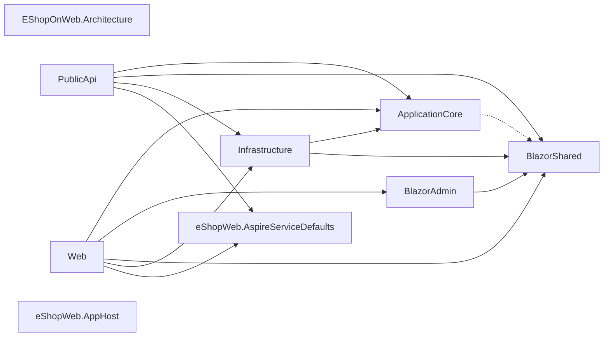
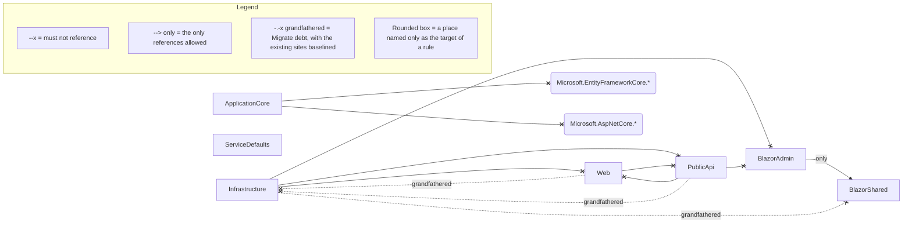

<!-- sliderule:begin -->
*Generated by `sliderule render` from `eShopOnWeb.slnx` — do not edit between the markers; re-render to update.*

*Generated by `sliderule render` from `EShopOnWeb.Architecture`. Do not edit between the markers; edit the spec and re-render.*

Not drawn in full: `layering/core-independent`, `layering/core-declares-no-blazor-shared` (Migrate), `layering/blazor-shared-independent`, `layering/service-defaults-independent`, `construction/ui-no-infrastructure-instantiation` (Migrate), `externals/ui-no-ef`, `naming/interfaces-prefix-i`, `naming/repository-implements-irepository`, `members/entity-fields-private`, `infrastructure/ef-migrations/tripwire` (Caution). Expand any of them with `sliderule explain <rule-id>`.
<!-- sliderule:end -->
